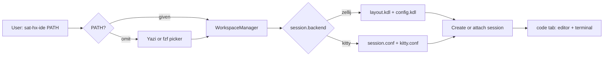

# sat-hx-ide architecture (process model)

sat-hx-ide composes a Helix-centered IDE workspace inside a **terminal multiplexer**.
Historically that multiplexer was always [Zellij](https://zellij.dev/); it remains the
**default** backend. A pluggable [`SessionBackend`](../src/backend/mod.rs) now also
implements [kitty](https://sw.kovidgoyal.net/kitty/) (remote control via `kitten`). You can
run sat-hx-ide from any terminal emulator; only the configured backend must be available.

Each keybinding spawns a short-lived `sat-hx-ide` helper process that drives the active
backend and exits. There is no background daemon.

## Session init

`init` / `start` are optional aliases for the same flow (`sat-hx-ide init [PATH]`).

1. Resolve the project directory (argument, or interactive picker when omitted) and session name.
2. Select backend: `zellij`, `kitty`, or `auto` (`KITTY_WINDOW_ID` → kitty, else Zellij).
3. Generate backend runtime files under `$XDG_RUNTIME_DIR/sat-helix-ide/<session>/`.
4. Merge helper keybindings into a private config copy (Zellij KDL or kitty `map` lines).
5. Create or attach the session.

Runtime files also hold optional `venv_*.json` / `venv_active` for virtual environment state.

## Session backends

| Backend | Merge source (read-only) | Runtime artifacts | Launch |
|---------|--------------------------|-------------------|--------|
| **Zellij** | `config.kdl` | `config.kdl`, `layout.kdl` | `zellij --config <runtime>` |
| **Kitty** | `kitty.conf` (`include` in runtime copy) | `kitty.conf`, `session.conf`, `kitty.sock`, … | Dedicated kitty + `allow_remote_control=socket-only` |

[`SessionBackend`](../src/backend/mod.rs) covers listing/spawning/focusing/resizing panes,
sending keys, and `init_session`. Zellij-specific generators live in [`src/zellij/`](../src/zellij/);
kitty layout and config generation in [`src/kitty/`](../src/kitty/). Helpers use
`backend::from_config` and backend-neutral [`PaneInfo`](../src/backend/mod.rs) records, so
[`src/actions.rs`](../src/actions.rs) has no direct multiplexer CLI calls.

**Kitty notes:** floating tools use overlay windows; fullscreen uses the `stack` layout.
Window moves are not available in kitty remote control, so docking is chosen at spawn time.

## Helper commands

The active backend binds these hidden `sat-hx-ide` subcommands (defaults shown):

| Key (default) | Command | Action |
|---------------|---------|--------|
| Ctrl-y | `__file-manager open` | Open/focus Yazi |
| Alt-y | `__file-manager toggle-dock` | Float or dock file manager |
| Alt-t | `__terminal toggle` | Hide/show terminal |
| Alt-Shift-t | `__terminal zoom` | Zoom terminal or dock back |
| Alt-g | `__git open` | Spawn configured Git TUI in floating pane |
| Alt-r | `__review open` | Spawn configured review tool in floating pane (default: revdiff) |
| Alt-v | `__venv toggle` | Activate/deactivate venv in terminal pane |
| Alt-Shift-v | `__venv select` | Venv selector TUI (floating pane) |
| (layout) | `__status-bar run` | Session/git/venv summary line on every tab |

On Zellij, helpers often run in tiny floating panes (`close_on_exit true`) so the
keybinding helper's TTY remains available (file-manager spawn).

## Action routing

All logic lives in [`src/actions.rs`](../src/actions.rs):

- **File manager** — If a `file-manager` pane exists, focus it; otherwise rename
  the helper pane and run Yazi in-process (chooser loop, open in Helix).
- **Terminal** — Toggle visibility via Zellij fullscreen or kitty stack layout; respawn
  terminal with layout-aware direction when the shell pane was closed.
- **Git** — Spawn a floating pane on the code tab with the resolved Git client.
- **Review** — Spawn a floating pane with the tool from `[tools.review]` (default `revdiff`).

## Pane cache

Within one helper invocation, pane list results are cached for 500 ms to avoid repeated
backend queries during multi-step actions. Resize operations live in the backends
(`resize_to_share`) and always read fresh geometry; the cache is invalidated after terminal respawn.

## Terminal layout

`[terminal]` in config controls the docked shell in the code tab:

- `enabled` — include terminal pane in layout
- `dock_percent` — size as % of the split
- `dock_position` — `down` (horizontal split, default) or `right` (vertical split)

Respawn uses the same direction and resizes against the editor pane.

## Configuration merge

sat-hx-ide never edits the user's global Zellij or kitty config. It reads the source
read-only, checks for key collisions, injects bindings into a session runtime copy, and
passes that copy to the backend. Zellij-only options include `[session] status_bar` (native
input-mode plugin) and `[keybindings] passthrough` (forward keys to Helix without lock mode).

## Related docs

- [README](../README.md) — usage and requirements
- IPC daemon experiment (not merged): see `feature/ipc-protocol` branch
